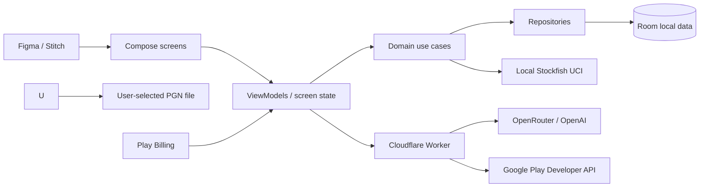

# Product and Technical Plan

## Product

Create an independent Android app for post-game chess learning. The player imports a PGN file from a source whose terms permit this use. The MVP has no game-site account connection or automatic game download. The app stores games and engine analysis on device, replays moves, shows Stockfish evaluations and up to five candidate continuations, explains consequential moves, supports contextual AI questions, and provides a clearly qualified performance-strength estimate.

The proposed price is **$9.99 one time** through a Google Play non-consumable purchase. This purchases a permanent app entitlement. Cloud AI has ongoing variable cost, so disclose an AI fair-use allowance before checkout; do not promise unlimited lifetime AI without a budget that supports it.

## Product and launch gates

1. **Third-party game-data terms:** The owner selected generic local PGN import for the MVP; no Chess.com API or account-sync integration is included. This does not establish rights to commercially analyze Chess.com-origin PGNs. The current Chess.com User Agreement says public game records may be monetized, while also restricting commercial, derivative, and download uses and requiring written authorization for certain AI/competitive-product uses. Keep imports source-neutral and do not market a Chess.com-specific import/companion feature until the applicable terms have been reviewed. No outreach has been initiated.
2. **Original product identity:** no Chess.com name in the product name, copied screens, logos, piece/board art, proprietary glyphs, sounds, or terminology. State clearly that the app is independent and unaffiliated.
3. **Stockfish licensing:** The owner selected the GPL open-source route. Stockfish 19 is included as a separate UCI process under GPL-3.0-or-later. Ship its license, exact source/build pointer, and release hashes; review Android installation-information and packaging obligations before public distribution. The app's own license is a separate decision.
4. **Lifetime unit economics:** model store proceeds, refunds/taxes, expected OpenRouter/OpenAI usage, abuse, and support; define AI limits, budget alerts, and the quota-exhaustion experience before setting the live price.
5. **Design handoff:** Figma/Stitch screens, assets, design tokens, and interaction states must be supplied before final UI implementation.

## MVP scope

- Compose onboarding, game library, game review, AI coach, paywall, settings, privacy and license screens based on approved Figma/Stitch designs.
- Generic PGN file import, local deduplication, and on-device game storage; no account connection or automatic import from game sites.
- Interactive replay with board, move list, move navigation, game metadata, and orientation.
- On-device Stockfish analysis, score by position, up to five MultiPV lines, cached results, progress/cancellation, and original move-quality labels.
- Game-level summary, key moments, review-quality statistics, and rough performance estimate with confidence/sample-size caveat.
- Contextual AI explanations and questions via Cloudflare Worker using the owner-selected OpenRouter route to `openai/gpt-4.1-mini` with OpenAI-only provider routing; production data-term approval and budget remain open.
- Google Play one-time purchase, restore flow, backend purchase-token verification, and disclosed AI fair-use limits.
- Offline replay and local Stockfish analysis; network required only for opt-in AI and Play billing operations.

## Recommended architecture



### Android

- Keep the current single `:app` module initially; the project is a small Compose starter.
- Kotlin + Jetpack Compose, Navigation Compose, coroutines/Flow, lifecycle ViewModels, Room for games/plies/reviews, DataStore for preferences.
- Suggested boundaries: `core/chess`, `core/engine`, `data/local`, `data/ai`, `data/billing`, `domain`, and feature packages for games/review/coach/settings.
- Put rules/PGN parsing behind an interface; verify candidate library's license, Android support, and maintenance before choosing it.
- Put Stockfish behind `ChessEngine`; run off main thread, serialize UCI access, support cancellation, clean up native processes, and version all engine/NNUE/settings data.

### PGN import

- Use the Android document picker for user-selected PGN files. Parse on device, preserve local data on malformed/unsupported input, and deduplicate imports in Room.
- Keep source-neutral import UI. Do not request game-site credentials, fetch archives, scrape websites, or imply that every source grants permission to use exported games in a paid analysis product.
- Store the imported PGN and derived review locally. Send no full PGN or archive to the AI service.

### Engine/review

- Use UCI MultiPV up to five; convert candidate PVs to SAN through the rules library. Persist engine identity, version, analysis settings, depth, scores, and timestamp.
- Normalize eval perspective consistently (recommend White-relative storage), handle mate scores separately, and show the displayed point of view clearly.
- Version classification heuristics. Compare played move to best continuation with perspective/mate/forced-move/endgame care. Explain labels as product estimates, not objective engine facts.
- Cache by FEN + engine version + settings. Make longer analysis optional and show battery/time implications, progress, cancellation, and incomplete states.
- A performance estimate must be a range with sample/confidence notes. Calibrate against a documented dataset before presenting numerical Elo; otherwise call it a rough estimate, not an official rating.

### AI and backend

- Cloudflare Worker holds the OpenRouter API key and Google Play service-account credentials. Android never carries these secrets.
- Worker enforces verified app/user identity, server-side Play entitlement, fixed SKU/model allowlist, strict request/response schemas, payload limits, per-user quotas, timeouts, circuit breaker, and redacted logs.
- Each AI call carries only current FEN/ply/question and relevant played move + up to five engine lines/evaluations/depth. Exclude full PGN, unrelated games, and unnecessary usernames.
- Require structured answers and validate before display. AI explains Stockfish data; it cannot produce authority for engine facts. On outage, retain local board/analysis and show an understandable retry/fallback.
- The approved OpenRouter route is restricted to the OpenAI provider. Production data-term approval and budget are still pending; recheck current provider terms and rates before enabling production AI.
- Worker is a relay/guardrail, not an engine host. Cloudflare Workers Free currently documents 100k requests/day and 10 ms CPU per request; recheck current quotas. Keep logs free of positions, PGNs, AI prompts, account identifiers, and purchase tokens.

### Billing and persistence

- Use Play Billing non-consumable SKU `premium_lifetime` (or rename before release); display the localized product price returned by Play.
- Verify purchase tokens using the current Google Play Developer API from the Worker and a server-held service-account credential. Reject wrong package/SKU, pending, invalid, or refunded purchases; support purchase restore and acknowledgement.
- Local `isPremium` is presentation cache only; never accept it as backend authority. Keep local game/review access usable if billing/network is unavailable.
- Avoid Firebase Cloud Functions/Firestore in MVP unless a concrete feature needs them. Firebase Spark quotas and paid Google Cloud features differ; “free backend forever” cannot be promised.

## Data contracts

```text
Game: id, source, sourceGameId, username, importedAt, playedAt,
      whitePlayer, blackPlayer, whiteRating?, blackRating?, timeControl?,
      result, pgn, variant, parseStatus

PlyAnalysis: gameId, ply, fenBefore, playedUci, playedSan,
             evalBefore, evalAfter, evalPerspective, mateState?,
             alternatives[0..5]{moveUci, moveSan, score, pvSan[], depth},
             label?, labelReason?, engineId, engineVersion,
             settingsHash, analyzedAt

GameReview: gameId, analyzedPlies, keyMoments[], summaryFacts[],
            accuracyEstimate?, performanceEstimateRange?, confidence,
            formulaVersion

CoachRequest: selectedGameId, selectedPly, fen, question, playedMove,
              engineEvidence[0..5], previousExplanationId?
```

## Official references

- [Chess.com User Agreement](https://www.chess.com/legal/user-agreement) (recheck source-specific terms before supporting or marketing PGNs from Chess.com)
- [Pinned Stockfish 19 source](https://github.com/official-stockfish/Stockfish/tree/edb0d9db6731067ec50ce619ff372b463bc4dd5d), [GPL guidance](https://stockfishchess.org/about/), and [NNUE network license/source](https://github.com/official-stockfish/networks)
- [Cloudflare Worker limits](https://developers.cloudflare.com/workers/platform/limits/) and [pricing](https://developers.cloudflare.com/workers/platform/pricing/)
- [Firebase plan behavior](https://firebase.google.com/docs/projects/billing/firebase-pricing-plans)
- [OpenRouter provider routing](https://openrouter.ai/docs/guides/routing/provider-selection) and [OpenAI API data controls](https://developers.openai.com/api/docs/guides/your-data)
- [KSP releases](https://github.com/google/ksp/releases)
- [Play one-time products](https://developer.android.com/google/play/billing/one-time-products), [purchase lifecycle](https://developer.android.com/google/play/billing/lifecycle/one-time), [Play purchase verification API](https://developers.google.com/android-publisher/api-ref/rest/v3/purchases.productsv2/getproductpurchasev2)

