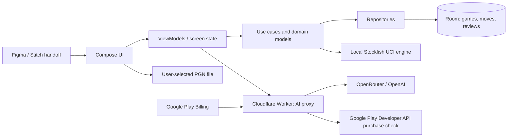

# AI Coding Agent Brief: Android Chess Game Coach

> **Navigation:** The repo-root agent instructions, concise product plan, implementation phases, acceptance checklist, and ready-to-paste prompts now live in [AGENTS.md](../AGENTS.md), [PLAN.md](../PLAN.md), [PHASES.md](../PHASES.md), [CHECKLIST_ACCEPTANCE.md](../CHECKLIST_ACCEPTANCE.md), and [AGENT_PROMPTS.md](../AGENT_PROMPTS.md). This file remains the longer technical reference.

**Status:** implementation plan; design handoff, third-party PGN source terms, and release verification are launch dependencies  
**Last checked:** October 15, 2026  
**Target:** native Android app, Kotlin + Jetpack Compose  
**Working product name:** Chessin' (owner-selected provisional name; final identity review remains open)

## 1. Agent charter

You are the senior Android engineer responsible for taking this repository from its starter screen to a release-ready, differentiated chess-learning app. Work phase by phase, keeping the checklist below current. Make each phase buildable before moving on. Prefer small, reviewable changes and explain decisions in the PR or handoff notes.

### Operating rules

- Treat the approved Figma/Stitch file and its exported assets as the visual source of truth. Do not invent a replacement design system. Before implementing UI, obtain screen links, assets, typography, colors, spacing, component states, and mobile breakpoints. If those are not available, finish architecture/domain groundwork and mark design-dependent tasks blocked.
- Make an independent product. Do not reuse Chess.com logos, board/piece artwork, sounds, branded colors, review screens, proprietary move glyphs, feature names, or a close copy of its layout. Use original product naming and original move-quality labels. Use “Compatible with Chess.com” only if appropriate and clearly state that the app is independent and unaffiliated.
- The owner selected source-neutral PGN file imports for the MVP. Do not add a game-site account/API connection or scrape websites. Rights for commercial analysis of third-party-origin PGNs remain unresolved; do not imply provider-specific approval. Analyze completed games only; never surface move suggestions during a live game.
- Keep provider secrets out of the Android application, source control, logs, crash reports, and client-visible configuration. Route model calls through a protected backend.
- Stockfish output is the source of truth for evaluations and candidate moves. The language model explains structured engine findings; it must not invent engine scores, principal variations, or a rating.
- Avoid collecting or uploading game history by default. Import and review on device. Send only the minimum position and analysis context needed for a user-requested AI explanation or question.
- Do not claim the entire service is permanently free. Free quotas, model access, terms, and API limits can change; implement graceful limits and document current assumptions.
- Do not silently change the one-time lifetime offer into a subscription. Surface usage caps and AI/model availability clearly before purchase.

## 2. Product goal

Build a post-game review and coaching app for Android. A player imports a PGN file from a source whose terms permit this use; the app stores and reviews it locally. The MVP does not connect to game-site accounts or fetch games automatically. The player can replay a game, inspect engine evaluations and up to five candidate continuations, understand consequential mistakes and strong ideas, ask contextual questions, and see a rough playing-strength estimate with a confidence indicator.

The proposed commercial model is one Google Play non-consumable purchase at **$9.99 once**. It unlocks a permanent app entitlement. The AI provider still incurs ongoing per-use cost, so “lifetime” access must have a disclosed fair-use limit or a deliberately budgeted amount of AI usage. Do not promise unlimited AI until unit economics support it.

### Launch gates — resolve before public sale

1. **Third-party PGN source terms:** The owner chose generic local PGN imports and removed game-site account/API sync from the MVP. The current Chess.com User Agreement says public game records may be monetized, but also restricts commercial, derivative, and download use and requires written authorization for certain AI/competitive-product uses. Do not assume Chess.com-origin PGNs are cleared for commercial post-game analysis, and do not market a Chess.com-specific import/companion feature until terms have been reviewed. No outreach has been initiated.
2. **Independent brand/design:** deliver original naming and screens. Chess.com’s guidance explicitly says third-party tools should not copy its UI, design, marks, or product terminology.
3. **Stockfish distribution review:** the owner selected Stockfish's GPL-3.0-or-later route. Stockfish 19 is bundled as a separate UCI process with GPL and NNUE CC0 notices, pinned source/build details, and hashes in `docs/third_party/stockfish/README.md`. Verify the exact Android packaging, source availability, installation-information, and Play delivery requirements before release. The app's own license remains a separate decision.
4. **Lifetime economics:** calculate expected gross proceeds after store fees, refunds/taxes, AI spend, and support. Define request caps, cost alerts, and behavior when quotas or budget are reached before publishing the $9.99 SKU.

## 3. Scope

### MVP

- Original Figma/Stitch-led Compose UI: game library, game review, AI coach/chat, purchase/paywall, settings/privacy/license information.
- Source-neutral PGN file import, on-device parsing, deduplication, and local history. No account connection or automatic game-site import is in the MVP.
- Interactive board replay with move navigation, move list, game metadata, side-to-move, result, and current ply.
- Local Stockfish analysis: evaluation by position; up to five MultiPV candidate moves with lines; progress, cancellation, and cached results.
- Original move-quality classification, generated from engine score changes plus position/move context. Distinguish standout ideas, strong moves, inaccuracies, mistakes, and severe blunders with explanatory labels. Do not imitate Chess.com’s glyphs, thresholds, colors, or branded terminology.
- Overall game report, key turning points, basic accuracy/quality summary, and an explicitly rough performance-strength estimate with confidence/sample-size caveat.
- Move explanations and contextual Q&A through a Cloudflare Worker using the owner-selected OpenRouter route to `openai/gpt-4.1-mini`, restricted to OpenAI. The model receives a compact, typed payload of facts from the app and returns a validated response; production data terms and budget remain pending.
- Google Play one-time non-consumable purchase and restore flow. Verify entitlement with Google Play’s backend API before allowing protected AI usage.
- Offline access to imported games and local engine results. Network is needed only for opt-in cloud AI and Play billing operations.

### Later, only after MVP is stable

- Multi-device sync/account, cloud-stored review results, extra import sources, opening repertoire insights, additional language models, or deeper training plans. Keep these out of MVP unless the design and commercial approval require them.

## 4. Recommended architecture



### Android app

- Keep the existing single `:app` module initially. The repository currently contains a minimal Compose `MainActivity`, theme, and starter tests; avoid premature multi-module architecture. Split modules only when engine/data boundaries justify it.
- Use Kotlin coroutines/Flow, lifecycle-aware ViewModels, immutable UI state, Navigation Compose, Room for imported games and analysis, and DataStore for preferences. Choose/verify a chess rules + PGN parser library before adding it; isolate it behind interfaces so it can be replaced.
- Suggested packages: `core/chess`, `core/engine`, `data/local`, `data/ai`, `data/billing`, `domain`, `feature/games`, `feature/review`, `feature/coach`, `feature/settings`, `ui/designsystem`.
- Keep PGN parsing and engine work off the main thread. Make engine requests cancellable and serialize access to the engine process.

### Data and PGN import

- Use the Android document picker for user-selected PGN files. Parse and validate locally; malformed or unsupported files must not erase existing games.
- Keep import UI source-neutral. Do not request provider credentials, fetch archives, scrape websites, or imply a third-party export is cleared for commercial use.
- Parse PGN/SAN into canonical game and ply records. Keep import date, stable dedupe key, event/date/time control, players/ratings, result, PGN, and parse status. Treat absent fields as normal.
- Store raw PGN and derived analysis locally. Use Room migrations and a delete-all/local-data control. Never upload whole-game archives for AI chat.

### Engine and classification

- Define `ChessEngine` with analysis request/result types independent of Stockfish. The owner selected a source build of Stockfish 19 under GPL-3.0-or-later. Pin source commit, NNUE network (CC0-1.0), Android build flags, ABI outputs, and hashes in `docs/third_party/stockfish/README.md`. Keep UCI stdout/stderr separate and ensure process cleanup. Android device execution and final installation-information review remain open.
- Use UCI `MultiPV=5` for up to five lines. Convert UCI moves to SAN through the chess rules layer. Return each line with score, depth, nodes/time where available, and PV. Normalize scores to the same perspective (recommend White’s perspective in storage and explicit side-to-move display in UI); handle mate scores separately from centipawns.
- Establish deterministic, documented analysis settings (depth/time budget, MultiPV, and engine version). Make deeper analysis optional because it uses battery and can take time. Cache positions by FEN + engine version + settings; show cache/depth and “analysis incomplete” states.
- Compare the played move with engine best move using the evaluation before/after move and best continuation; account for side-to-move sign, mate values, forced moves, opening book/low-material edge cases, and transpositions. Keep thresholds in one tested configuration and version them. Do not equate one centipawn threshold with universal human error.
- Class labels and summaries are product heuristics, not engine facts. Keep the original vocabulary and explain the reason (e.g., “missed a defense,” “allowed a forcing tactic,” “found a difficult resource”).

### AI service and security

- Android sends AI requests only to a versioned Cloudflare Worker endpoint. The Worker holds the OpenRouter API key as a secret and enforces request-size limits, an OpenAI-only provider route, schema validation, per-user/per-day limits, timeouts, and safe error responses. Never accept a model name, arbitrary URL, or free-form system prompt from the client.
- Protect the endpoint with verified app/user identity and a verified Play purchase token. Investigate Firebase App Check/Play Integrity and Firebase Auth only if they solve a concrete identity or abuse-control need; do not introduce Firestore/Cloud Functions solely by habit. The Worker must validate tokens server-side; a client “isPremium=true” flag is never authority.
- Use Google Play Developer API `purchases.productsv2.getproductpurchasev2` (or its current successor) to verify the fixed non-consumable SKU and purchase token. Keep service-account credentials in Worker secrets. Reject pending, refunded/invalid, wrong-package, and wrong-SKU transactions. Acknowledge the purchase according to current Play Billing requirements and provide Restore Purchases.
- AI payload: current FEN, move number, side to move, played SAN, game context, before/after evaluation, five engine alternatives with PV/eval/depth, and original label. Include the user’s question and only relevant nearby moves. Exclude Chess.com account credentials (none should exist), unnecessary usernames, and unrelated games.
- Require structured JSON output with `summary`, `why_played_move_matters`, `candidate_explanations`, `answer`, and `caveats`. Validate output before showing it. If AI fails, show the verified engine facts and retry affordance. Do not present a hallucinated explanation as a Stockfish result.
- Add privacy copy before first AI call. The owner-approved OpenRouter/OpenAI route and development key cap are recorded in `docs/DECISION_REGISTER.md`; production provider terms, budget, and fair-use limits remain pending. Recheck current official terms and pricing before enabling production requests.
- Store no game/AI chat history on the Worker unless a later requirement justifies it. If abuse metering needs persistence, choose KV/D1 after checking current quotas and retention requirements. Keep logs metadata-only and redact FEN, PGN, prompt, and purchase token.

### Hosting and cost assumptions

- Cloudflare Workers Free currently documents 100,000 requests/day, 10 ms CPU per request, and 50 subrequests/request. A Worker that mainly validates, forwards, and streams/waits on a model network call is a better fit than putting Stockfish analysis there. Recheck limits before deployment.
- Firebase Spark provides no-cost services/quotas, but paid Google Cloud features require Blaze; exceeding some Spark quotas can stop the affected service until the next cycle. Do not make the MVP depend on Cloud Functions being free.
- Never put the OpenRouter key in the APK. Keep production AI disabled until provider data terms, budget, and disclosed fair-use limits are approved; handle exhausted quotas safely.
- The $9.99 Play product is non-consumable. Store the purchasable product ID in one config location (for example, `premium_lifetime`) and use Play Billing rather than an external checkout for Android digital features. Display localized Play-provided price, not a hard-coded dollar conversion.

## 5. UX and design handoff checklist

Before UI implementation, get the Figma/Stitch project and settle these screens/states:

- [ ] Onboarding and privacy/AI consent.
- [ ] Game library: loading, empty, offline, PGN import, unsupported-file, and parse-error states.
- [ ] Review: board orientations, move navigation, selected move, eval bar/graph, candidate lines, move labels, AI explanation, question entry, and analysis progress/cancel.
- [ ] Game summary: result, quality overview, turning points, performance estimate and confidence explanation.
- [ ] Paywall: one-time price, exactly what lifetime purchase unlocks, any AI fair-use limit, restore, terms, and purchase pending/failure/success.
- [ ] Settings: AI data explanation, usage status, delete local data, licenses, contact, and independent-product notice.
- [ ] Accessibility: text scaling, contrast, TalkBack labels for board squares/moves, minimum touch targets, and color-independent move labels.
- [ ] Export all assets with licenses/source documented. Use original board and piece design.

## 6. Phased implementation plan and exit checklists

### Phase 0 — Product, legal, and design discovery

- [ ] Obtain Figma/Stitch URL, screen set, assets, typography, tokens, and interaction notes.
- [x] Record the owner's PGN-only MVP decision; review third-party source terms before source-specific commercial marketing.
- [x] Record the owner's provisional product name, Chessin'; final name/trademark clearance and identity review remain open.
- [x] Record the GPL route and pin Stockfish 19 source, NNUE, ABI binaries, hashes, and notices; review final Android distribution requirements before release.
- [ ] Decide AI production tier, disclosed fair-use allowance, model privacy terms, and maximum monthly AI spend.
- [ ] Confirm Play purchase account/package setup, SKU, restore behavior, refund handling, and billing backend approach.

**Exit:** no unresolved blocker that would make paid release non-compliant or uneconomic; Figma handoff is actionable.

### Phase 1 — App foundation and design system

- [ ] Replace starter `Greeting` screen with navigation shell following Figma.
- [ ] Add app-wide typography/color/spacing/shape tokens and reusable components.
- [ ] Define domain models, repository interfaces, error/result types, and immutable screen state.
- [ ] Add Room entities/DAO/database and DataStore settings with schema migrations.
- [ ] Add dependency/version entries through the version catalog; keep secrets and local config out of Git.
- [ ] Add loading/empty/error/offline UI states before connecting services.

**Exit:** app launches into the designed shell; screens render with previews and navigation state is restorable.

### Phase 2 — Chess rules, PGN, and local library

- [ ] Select and pin a rules/PGN parser after checking license, maintenance, Android compatibility, and SAN/FEN support.
- [ ] Parse/import representative PGNs including castling, en passant, promotions, comments, clocks, missing ratings, and malformed files.
- [ ] Implement board state from FEN and legal move playback.
- [ ] Save games locally; dedupe imports and persist selected game/ply.
- [ ] Add PGN document picker and robust import errors.

**Exit:** imported PGN replays accurately after app restart; invalid games do not crash the library.

### Phase 3 — PGN-only import scope

- [x] Keep source-neutral user-selected PGN import and local persistence.
- [x] Remove game-site API/account sync implementation and stored username preferences from the MVP.
- [ ] Review third-party source terms before describing provider-specific import or commercial support.

**Exit:** PGNs import and stay local; no account connection, automatic game-site download, or scraping is part of the MVP.

### Phase 4 — Local engine and review data

- [x] Integrate source-built Stockfish 19 behind `ChessEngine`; bundle GPL/CC0 notices and source/build/hash details. Device execution and final installation-information review remain open.
- [x] Implement process lifecycle, UCI parser, readiness, cancellation, timeouts, and supported ABI handling; physical-device execution remains unverified.
- [x] Implement `MultiPV=5` analysis and UCI-to-SAN PV conversion.
- [x] Persist engine/version/settings metadata and cache by position.
- [x] Implement perspective/mate-safe evaluations and versioned move-quality heuristics.
- [x] Ensure analysis runs off the UI thread with progress and a user-controlled depth/time option.

**Exit:** same position/settings produce stable top lines and perspective-correct scores; app remains responsive and engine shuts down cleanly.

### Phase 5 — Review experience and game-level insights

- [ ] Wire board playback to eval graph, selected move, alternatives, labels, and continuation navigation.
- [ ] Add key moment list and summary generated only from stored engine facts.
- [ ] Define accuracy/performance-estimate formula, calibration source, sample size, time-control handling, and confidence display. If not calibrated, call it a rough estimate and avoid an authoritative Elo claim.
- [ ] Add loading, insufficient-analysis, forced-move, endgame, and no-engine-result states.
- [ ] Verify screen behavior against the Figma/Stitch handoff on small and large Android displays.

**Exit:** a user can replay a full game, inspect any move, compare five lines, and understand why each labeled move matters.

### Phase 6 — AI coach and protected Worker

- [ ] Create a minimal Worker with endpoint versioning, strict request/response schemas, secrets, CORS allowlist, request size limits, timeouts, and redacted logging.
- [ ] Validate identity/App Check and server-side Play entitlement before proxying model calls.
- [ ] Add per-user usage limits, duplicate-request cache where appropriate, and a circuit breaker for provider quota/budget exhaustion.
- [ ] Send compact engine-grounded context; parse/validate structured model responses and safely render markdown/text.
- [ ] Add first-use privacy notice, user-initiated request affordance, contextual follow-up questions, and graceful fallback when AI is unavailable.
- [ ] Keep model endpoint and Worker base URL configurable per build variant; no credentials in client resources.

**Exit:** AI explains only the currently selected game position and engine evidence; all quota, auth, network, invalid-response, and disabled-service cases are understandable.

### Phase 7 — Play Billing and entitlement

- [ ] Configure one non-consumable product at $9.99 in Play Console; use product details returned by Play in the UI.
- [ ] Integrate BillingClient purchase, pending state, acknowledgement, duplicate handling, restore/query purchases, and retry/reconnect.
- [ ] Verify purchase token against Google Play Developer API in Worker using a server-held service account; validate package, fixed SKU, purchase state, and refund/revocation state.
- [ ] Do not trust a local boolean entitlement for backend AI requests. Keep offline engine/reviews available while the verified paid entitlement persists.
- [ ] Display one-time nature, permanent app entitlement, AI-use limit, privacy terms, restore, and support contact before checkout.
- [ ] Test Play license accounts and pending/refund/reinstall/second-device paths.

**Exit:** purchase and restore work through Play; a false/expired/refunded token cannot unlock server AI; users do not lose local games if billing is unreachable.

### Phase 8 — Release readiness

- [ ] Run authorized automated unit/instrumentation checks for PGN/rules, UCI/evaluation normalization, move labels, AI schema, and purchase states.
- [ ] Manually verify Figma screen states, accessibility, large font, offline behavior, low-memory behavior, engine execution/cancellation, and supported ABIs on physical/emulated devices, including 16 KB page-size compatibility.
- [ ] Run dependency/license inventory; publish Stockfish and parser notices/source instructions where required.
- [ ] Complete privacy policy, AI/provider disclosure, deletion instructions, store listing, data-safety form, support contact, and independent-product disclaimer.
- [ ] Configure production secrets, app signing, Play internal testing, crash reporting without game contents, quota alerts, and AI cost monitoring.
- [ ] Review third-party PGN source terms and recheck model/data terms, Cloudflare quotas, and Play Billing docs immediately before release. No Chess.com API integration is in the MVP.
- [ ] Build release AAB and verify upgrade/install, restore, and app startup from a clean device.

**Exit:** all launch gates are documented as resolved; release candidate is signed, installable, and within the disclosed AI usage/cost envelope.

## 7. Acceptance criteria

- A player can import a PGN, replay it, and use the local library offline.
- Game moves, board positions, and SAN are legal and consistent through replay.
- A reviewed position shows a correctly oriented score, up to five legal engine continuations, evaluation depth/settings, and a clear incomplete-analysis state when work is cancelled or limited.
- Move labels and the overall report derive from engine comparisons and are described as app estimates. “Estimated Elo” is not represented as Chess.com rating or a guaranteed rating prediction.
- The coach can explain the selected move and answer follow-up questions using the supplied engine lines; it does not fabricate best moves or evaluations.
- Network/AI/provider outages never erase local games or block local replay/engine analysis.
- Play purchase is one-time and restorable. Server access is gated by verified entitlement, and limits/cost behavior are disclosed.
- No Chess.com credentials are requested; no scraping or live-game advice is present; the app’s visual identity is clearly its own.
- All bundled open-source licenses and corresponding-source obligations are met before distribution.

## 8. Suggested initial data contracts

```text
Game
  id, source, sourceGameId, username, importedAt, playedAt
  whitePlayer, blackPlayer, whiteRating?, blackRating?, timeControl?
  result, pgn, variant, parseStatus

PlyAnalysis
  gameId, ply, fenBefore, playedUci, playedSan
  evalBefore, evalAfter, evalPerspective, mateState?
  alternatives[0..5] { firstMoveUci, firstMoveSan, score, pvSan[], depth }
  label?, labelReason?, engineId, engineVersion, settingsHash, analyzedAt

GameReview
  gameId, analyzedPlies, keyMoments[], summaryFacts[]
  accuracyEstimate?, performanceEstimateRange?, confidence, formulaVersion

CoachRequest
  selectedGameId, selectedPly, fen, question, playedMove
  engineEvidence[0..5], previousExplanationId?
```

Keep server payload types separate from Room entities. Validate every external field and do not serialize the entire database into a prompt.

## 9. Official references (recheck before implementation/release)

- [Chess.com User Agreement](https://www.chess.com/legal/user-agreement) (review before source-specific commercial PGN support)
- [Stockfish 19 source/release](https://github.com/official-stockfish/Stockfish/tree/edb0d9db6731067ec50ce619ff372b463bc4dd5d), [GPL guidance](https://stockfishchess.org/about/), and [NNUE network license](https://github.com/official-stockfish/networks)
- [Android 16 KB page-size guidance](https://developer.android.com/guide/practices/page-sizes)
- [Cloudflare Workers limits](https://developers.cloudflare.com/workers/platform/limits/) and [pricing](https://developers.cloudflare.com/workers/platform/pricing/)
- [Firebase pricing plans](https://firebase.google.com/docs/projects/billing/firebase-pricing-plans)
- [KSP releases](https://github.com/google/ksp/releases)
- [OpenRouter provider routing](https://openrouter.ai/docs/guides/routing/provider-selection) and [OpenAI API data controls](https://developers.openai.com/api/docs/guides/your-data)
- [Google Play one-time products](https://developer.android.com/google/play/billing/one-time-products), [purchase lifecycle](https://developer.android.com/google/play/billing/lifecycle/one-time), and [backend purchase verification API](https://developers.google.com/android-publisher/api-ref/rest/v3/purchases.productsv2/getproductpurchasev2)

